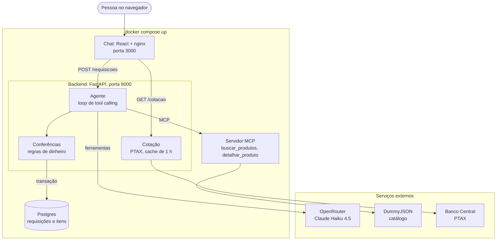

# BuyME: agente de compras

*Buy* + *ME*: o agente de compras pensado para o dia a dia da Mercado Eletrônico.

A pessoa escreve o que precisa num chat. O agente busca no catálogo da DummyJSON por um servidor 
MCP, escolhe os itens e salva uma requisição de compra no Postgres. Se nada atende, diz o que faltou, 
sugere o que existe e não cria requisição. Nenhum produto ou preço inventado chega à requisição, e 
nenhum erro passa em silêncio.

## Como funciona

1. A pessoa escreve o pedido no chat (React), que o envia para `POST /requisicoes` junto com as
   mensagens recentes da conversa, como contexto.
2. O backend chama o modelo (Claude Haiku 4.5, pela OpenRouter) com as ferramentas que o
   servidor MCP anuncia.
3. O modelo decide o que fazer: busca no catálogo (`buscar_produtos`), detalha um item
   (`detalhar_produto`) e repete até ter o que precisa. O servidor MCP consulta a DummyJSON.
4. O modelo responde com os itens escolhidos (id e quantidade), o orçamento que leu no pedido e o
   critério: o mais barato que atende, ou a necessidade que a pessoa disse. Se falta o essencial
   (o quê, quantos ou um critério), ele pergunta mostrando o que existe.
5. O backend confere contra o catálogo tudo o que envolve dinheiro: preço, estoque, pedido mínimo,
   orçamento e moeda. Se algo não confere, o modelo recebe o motivo e corrige uma vez.
6. Com tudo certo, a requisição e os itens são gravados juntos no Postgres. O chat mostra o
   número, os itens, o prazo de envio de cada um, o total e as outras opções que também cabem, com
   quanto cada uma acrescentaria ao pedido. Se nada atende, explica o que faltou e nada é gravado.

**Arquitetura: as quatro peças e os serviços externos**



O caminho completo de um pedido, com as conferências e as revisões, está em
[docs/DETALHES.md](docs/DETALHES.md#o-caminho-de-um-pedido-do-chat-ao-postgres).

## Como rodar

Precisa de Docker com o Compose.

```bash
cp .env.example .env    # cole a chave da OpenRouter em OPENROUTER_API_KEY (por boa prática, chave não se versiona)
docker compose up
```

Abra **http://localhost:3000** e envie o pedido de exemplo, que já vem preenchido.

- **Porta em uso?** Troque `CHAT_PORT` (3000) ou `API_PORT` (8000) no `.env` e suba de novo.
- **Mudou o código?** Use `docker compose up --build`. **Começar do zero?** Use `docker compose down -v`.

## Principais decisões

1. **O modelo decide quais ferramentas chamar.** O loop de tool calling é escrito à mão, sem
   framework, e não tem fluxo fixo ([backend/agente.py](backend/agente.py)).
2. **Tudo o que envolve dinheiro é conferido no código, nunca pelo LLM.** Preço, estoque, pedido
   mínimo do fornecedor, orçamento, moeda e total vêm do catálogo e do código
   ([backend/validacao.py](backend/validacao.py)).
3. **Sem necessidade dita, o mais barato que atende.** O limite de preço é teto, não meta. O código
   confere a escolha e monta a lista das outras opções que cabem, com a diferença no pedido e o
   prazo de envio, para quem compra decidir se vale pagar mais.
4. **Nenhum erro silencioso.** Toda falha tem código, mensagem clara no chat e linha no log
   ([tabela](docs/DETALHES.md#tratamento-de-erros)).
5. **Modelo `anthropic/claude-haiku-4.5`.** A chave do case bloqueia provedores sem
   *Zero Data Retention*. Custa cerca de US$ 0,009 por mensagem ([custo](docs/DETALHES.md#custo)).
6. **Gravar fica no backend, não numa 3ª ferramenta MCP.** A escrita passa pelas conferências do
   item 2 numa transação: requisição e itens entram juntos, ou nada entra.

## Testes e qualidade

- **60 testes unitários, sem chave de LLM e sem rede:** 8 das ferramentas do MCP e 52 das regras,
  dos erros, da conversa e da cotação. O CI roda lint, testes e build.
- **`scripts/avaliar.py`:** 14 casos com resultado esperado, 3 deles em forma de conversa e 7 que
  **não** devem ser atendidos. Resultado: 14/14.
- **`scripts/qa_riscos.py`:** 24 cenários de prejuízo (orçamento, moeda, estoque, pedido mínimo,
  manipulação do pedido e do histórico) e auditoria do banco contra o catálogo. Resultado: 24/24.
- **`scripts/jornadas.py`:** as conversas de um comprador, impressas para leitura.

## Uso de IA

Construído com o Claude Code. Eu defini o escopo, a ordem das peças e o critério de pronto, revisei
as decisões e usei o chat como comprador. O Claude Code escreveu a maior parte do código e, a meu
pedido, atuou como QA focado em prejuízo ([detalhes](docs/DETALHES.md#como-usei-ia)).

## Mais detalhes

[docs/DETALHES.md](docs/DETALHES.md) tem as peças e portas, o caminho de um pedido, o agente e a
conversa, o que sabemos do
catálogo (desconto, prazo, nota, garantia), a cotação do dólar, a bateria de QA, o custo medido, a
tabela de erros e os limites conhecidos.
