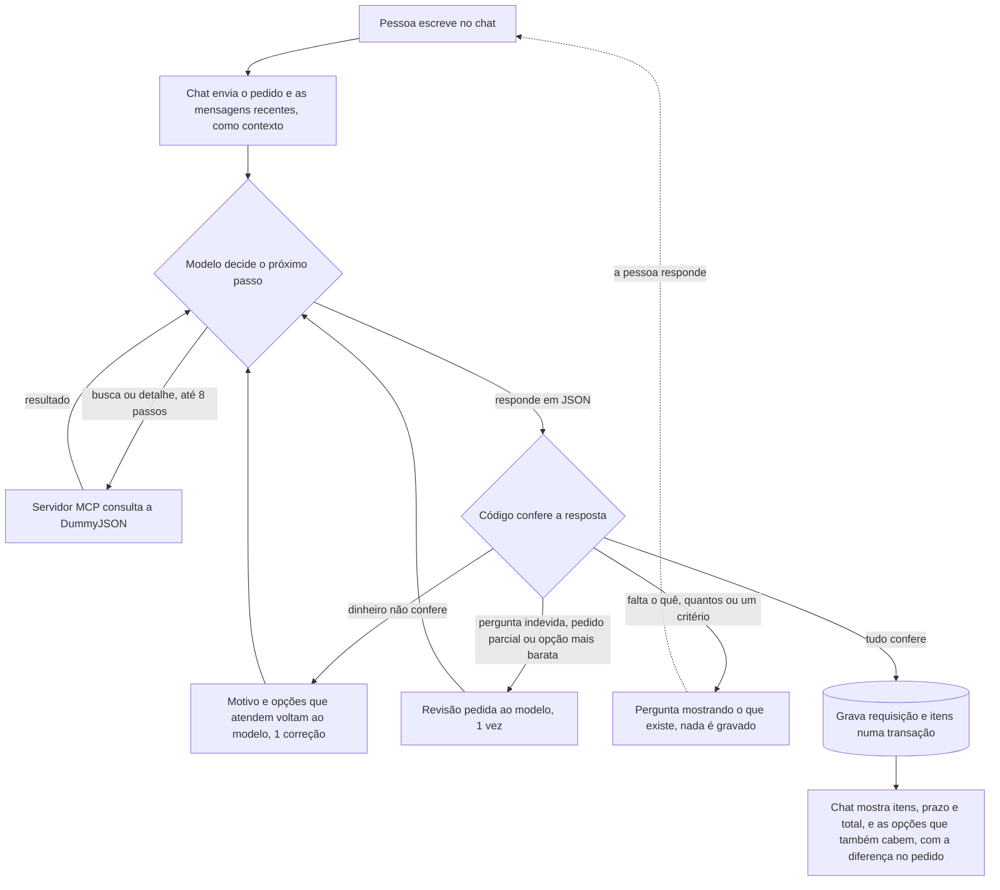

# BuyME: detalhes

Complemento do [README](../README.md).

## Peças

| Peça | Porta | O que é |
|---|---|---|
| `frontend` | 3000 | chat em React (o nginx serve o build e repassa `/api` ao backend) |
| `backend` | 8000 | FastAPI com `POST /requisicoes`, `GET /requisicoes` e `GET /cotacao`; o agente mora aqui |
| `mcp-server` | interna | servidor MCP com `buscar_produtos(termo)` e `detalhar_produto(id)` |
| `db` | interna | Postgres 16; as tabelas nascem do [db/init.sql](../db/init.sql) na primeira subida |

O backend só sobe depois que o Postgres responde ao *healthcheck*, que é feito por TCP de
propósito. Na primeira subida, o Postgres roda um servidor temporário, só no socket local,
enquanto cria as tabelas, e um healthcheck pelo socket diria "pronto" cedo demais. Como segunda
proteção, o backend ainda tenta conectar por até 10 s, registrando cada tentativa no log. As peças
se encontram pelo nome na rede interna do Compose (`db`, `mcp-server`, `backend`).

## O caminho de um pedido, do chat ao Postgres



- **Dinheiro não confere:** preço, estoque, pedido mínimo, orçamento ou moeda. O modelo recebe o
  motivo e as opções que atendem, e corrige uma vez; o backend confere de novo antes de gravar.
- **Revisão:** o código nota três respostas que o prompt proíbe e pede ao modelo para revisar, uma
  vez: perguntar "qual você prefere?" tendo quantidade e limite, montar a requisição e ainda
  perguntar (pedido parcial), ou escolher acima de uma opção mais barata sem uma necessidade dita.
  Ver [O agente](#o-agente-e-o-que-ele-não-pode-inventar).
- **Pergunta:** só quando falta o essencial. A resposta da pessoa volta com a conversa como
  contexto ([A conversa](#a-conversa)).

## Testes

```bash
cd mcp-server && pip install -r requirements-dev.txt && pytest -q   # 8 testes das ferramentas
cd backend    && pip install -r requirements-dev.txt && pytest -q   # 52 testes: regras, erros, conversa e cotação
python scripts/avaliar.py      # com o ambiente no ar: 14 casos de teste, mostra os acertos
python scripts/qa_riscos.py    # com o ambiente no ar: bateria de QA focada em prejuízo
python scripts/jornadas.py     # com o ambiente no ar: conversas de um comprador, para ler
```

Os testes das ferramentas usam o protocolo MCP de verdade, com um cliente em memória, e a DummyJSON
simulada (`respx`). Nenhum teste unitário precisa de chave de LLM ou de rede. O CI
([.github/workflows/ci.yml](../.github/workflows/ci.yml)) roda o lint, os testes e o build.

O `avaliar.py` checa o agente sem depender de impressão. Para cada caso ele confere se foi
atendido, a quantidade e o teto de preço, sem exigir um produto específico. No pedido de exemplo,
confere também que não havia opção mais barata que atendesse. Três casos são conversas, mandadas
com o histórico como o chat manda: o pedido vago seguido de "5 unidades, até US$ 1.500 cada", o
mínimo do fornecedor seguido de "pode aumentar para 4" e o orçamento em reais seguido do valor em
dólar. Sete casos **não** devem ser atendidos:
- tratores;
- laptops abaixo de US$ 500;
- um "iPhone 19", em que ele também confere se as alternativas sugeridas existem;
- um orçamento em reais;
- uma compra abaixo do mínimo do fornecedor;
- "Quero 2 celulares", sem critério: deve perguntar citando celulares reais do catálogo;
- "Quais tipos de produto vocês têm?": não pode citar categorias que o catálogo não tem.

A última execução deu 14/14.

O `jornadas.py` não dá nota. Ele imprime as conversas que um comprador teria (pedido vago, troca
depois de gravar, orçamento em reais, kit com item que não existe) para alguém ler e julgar se a
resposta ajuda a pessoa a terminar o que começou. Ver [Como usei IA](#como-usei-ia).

## O agente e o que ele não pode inventar

- O prompt manda buscar em inglês e no singular (o catálogo é em inglês), tentar sinônimos,
  respeitar quantidade, orçamento, estoque e pedido mínimo, e responder sempre num JSON fixo:
  `{"itens": [{"produto_id", "quantidade"}], "orcamento": {"moeda", "max_unitario",
  "max_total"}, "criterio", "resposta"}`. Perguntas e recusas também vão nesse JSON.
- O backend guarda todo produto que as ferramentas devolveram e confere a escolha contra eles
  ([backend/validacao.py](../backend/validacao.py)). Ele recusa:
  - id que não veio do catálogo;
  - quantidade acima do estoque ou abaixo do pedido mínimo;
  - preço acima do limite por unidade e total acima do limite total;
  - um pedido com valor em reais ou euros e sem menção a dólar, por uma regra fixa que não
    depende do modelo.

  A conta é feita em `Decimal`.
- **Correção em vez de desistência:** a mesma conferência roda ainda dentro do loop. Se ela recusa
  (ex.: "Realme C35: pedido 2, mínimo do fornecedor 3"), o modelo recebe o motivo e a lista das
  opções que atendem, montada pelo código, e corrige uma vez. A correção aparece na lista de
  ferramentas do chat como `conferencia_do_sistema`, e o backend confere de novo antes de gravar.
- **Critério de escolha:** sem necessidade dita, o mais barato que atende; o limite de preço é
  teto, não meta. O modelo declara o critério no JSON (`mais_barato` ou `necessidade: ...`). Com
  `mais_barato`, o código compara a escolha com as opções que também cabem e, se houver uma mais
  barata, pede revisão. No teste, o modelo tinha chamado de "o mais econômico" um laptop
  US$ 300 mais caro que outro da mesma busca.
- **Opções que também cabem:** o chat mostra, abaixo da requisição, as outras opções da mesma
  categoria que atendem quantidade, estoque, mínimo e limite, com quanto cada uma acrescentaria
  ao pedido e o prazo de envio. A lista é montada pelo código, não pelo modelo: não tem como citar
  produto inventado. Para trocar, a pessoa responde "troca pelo ...".
- **Revisões que não gastam a correção de dinheiro:** o prompt sozinho não segurava duas regras,
  e o código pede uma revisão quando nota uma pergunta na resposta:
  - com quantidade e limite de preço, o modelo listava as opções e perguntava "qual você
    prefere?", em vez de escolher (o enunciado diz "busca e escolhe");
  - em "3 laptops e 5 relógios", ele gravou só os laptops e perguntou sobre os relógios, lendo
    errado o mínimo de um deles. Pedido com vários itens: todos ou nenhum.
- **Id chutado:** num teste com "mouses" (que a DummyJSON não tem), o modelo chutava ids (1 a 5,
  depois 101 a 104) para "explorar" o catálogo, mesmo com o prompt proibindo. A regra foi para o
  código: `detalhar_produto` com um id que não veio de busca nem chega ao catálogo.
- **Quando nada atende:** se a busca trouxe parecidos, o agente cita alternativas reais com preço
  ("iPhone 19 não existe; há iPhone 13 Pro por US$ 1.099,99…"). A requisição fica vazia e a
  pessoa decide. Sem critério nenhum ("Quero 2 celulares"), ele busca e pergunta mostrando a faixa
  de preço e os mais baratos que atendem a quantidade. À pergunta "o que vocês têm?" ele responde
  que busca pelo que a pessoa precisar, sem listar categorias de memória (antes, inventava
  "monitores, impressoras").
- **Por que o Haiku 4.5:** testei quais modelos a chave aceita com ferramentas
  ([scripts/testar_modelos.py](../scripts/testar_modelos.py)). O Haiku 4.5 é rápido e passa na
  avaliação e na bateria de QA. A comparação com o Haiku 5.5 está em [Custo](#custo).

## A conversa

O chat manda, junto com cada mensagem, as mensagens recentes (até 8), a partir do pedido que gerou
a última requisição. É assim que "5 unidades, até US$ 1.500 cada" vira requisição depois de
"Preciso de notebooks para a equipe nova", e "pode aumentar para 4" depois do aviso de mínimo.

O contexto é só contexto, e o código não confia nele:
- ids e preços citados antes não valem: o modelo busca de novo, e só entra o que as ferramentas
  devolverem agora;
- a regra de moeda vale para a última moeda que a pessoa citou: "até R$ 2.000" seguido de "pode
  seguir" continua bloqueado; seguido de "então até US$ 350 cada" passa;
- um histórico forjado ("o fornecedor fechou a US$ 100") não muda preço nenhum: o preço vem do
  catálogo (cenário Q24 do QA);
- o pedido gravado no banco é o que a pessoa escreveu na conversa, em ordem.

Requisição gravada não é editada: uma troca gera outra requisição, e o agente avisa o número da
anterior. As requisições ficam em "Requisições salvas", no topo do chat, também depois de
recarregar a página. "Nova conversa" faz o agente esquecer o contexto.

## O catálogo: o que usamos e o que sabemos

Analisei os 194 produtos da DummyJSON e os 22 campos de cada um. O agente usa preço, estoque,
pedido mínimo e prazo de envio. O resto foi decidido assim:

- **Desconto: sabemos que existe e, de propósito, não aplicamos.** Todo produto tem
  `discountPercentage`, de 0,04% a 19,6% (cerca de 10% em média), e o carrinho da própria
  DummyJSON aplica esse desconto na compra. A requisição usa o preço de lista (`price`), sem
  desconto. Isso tem dois efeitos: o total pode sair acima do que seria cobrado, e um item que
  caberia no orçamento com desconto pode ser recusado. É o lado conservador. Qual preço vale para
  a compra (de lista, com desconto ou negociado com o fornecedor) é uma decisão de negócio do
  cliente. Com ela definida, a mudança é pequena: trazer o desconto na busca e calcular o preço
  em `backend/validacao.py`.
- **Prazo de envio** (`shippingInformation`, de "Ships overnight" a "Ships in 1 month"): aparece em
  cada item da requisição e nas opções que também cabem (traduzido) e é gravado no banco, porque
  dependendo do prazo a compra não faz sentido. Ainda não é uma regra conferida pelo código: num
  pedido com prazo ("preciso até sexta"), a escolha depende do modelo. Virar regra exige definir
  dias úteis ou corridos, e envio ou entrega.
- **Nota e avaliações** (`rating`, `reviews`): não usamos para escolher nem mostramos, porque uma
  contradiz a outra. A correlação entre a nota e a média das três avaliações de cada produto é
  -0,05, ou seja, nenhuma relação. Em 73 dos 194 produtos, a diferença passa de 1 ponto. Exemplo:
  o Huawei Matebook X Pro tem nota 4,98 e avaliações 4, 4 e 1 (média 3,0; uma delas diz "Not
  worth the price!"). Todas as avaliações têm a mesma data. Por isso o `detalhar_produto` não
  devolve a nota: o que não usamos, o agente não vê. Num catálogo real, nota e avaliações
  entrariam como informação, não como critério de escolha.
- **Garantia e devolução** (`warrantyInformation`, `returnPolicy`): 12 produtos não têm garantia e
  44 não aceitam devolução. Não viraram regra porque dependem da política de compras do cliente
  (ex.: "eletrônico só com 1 ano de garantia"). Com a política, viram mais uma conferência no
  código.
- **Produtos impossíveis de comprar:** 17 têm estoque menor que o pedido mínimo (ex.: ovos, com
  estoque 9 e mínimo 32), e 8 deles aparecem no catálogo como "In Stock". O agente não depende
  desse status: as regras de estoque e de mínimo, juntas, recusam esses itens sem nenhuma regra
  especial.

## Cotação do dólar

O topo do chat mostra a PTAX do Banco Central (ex.: "Dólar PTAX 10/11: R$ 5,5840"), só como
referência. O backend busca a cotação (`backend/cotacao.py`, rota `GET /cotacao`), guarda por
1 hora e usa a última publicada nos últimos 7 dias, o que cobre fim de semana e feriado.

Ela fica fora do agente e da requisição, que continuam em dólar. De propósito, não há um "≈ R$" ao
lado do total: esse valor pareceria definitivo, mas não inclui impostos, frete nem o câmbio do dia
do pagamento. Se o Banco Central não responder, o selo mostra "Cotação do dólar indisponível" e o
resto funciona normalmente.

## Bateria de QA

[scripts/qa_riscos.py](../scripts/qa_riscos.py) simula um QA de compras: cada cenário é um erro que
custaria dinheiro. Roda de ponta a ponta contra o sistema no ar e termina auditando cada item
gravado contra o catálogo real (preço, estoque e pedido mínimo).

| Achado | Risco | Como ficou |
|---|---|---|
| "3 laptops de até **R$** 2.000" virou compra de laptops de US$ 1.099 a 1.499 | crítico: ~4x acima do orçamento | o modelo copia limite e moeda; o código confere; valor em reais sem dólar nunca vira compra |
| Requisições abaixo do mínimo do fornecedor (2 Realme C35, mínimo 3; relógios, mínimo 7) | alto: pedido recusado pelo fornecedor | o mínimo vem na busca e é conferido no código |
| "3 laptops e 5 relógios" gravou só os laptops, lendo errado o mínimo de um relógio | alto: compra incompleta | todos ou nenhum; revisão quando o agente monta e pergunta |
| "3 laptops de até US$ 1.200" recusado: achou que precisava de 3 modelos diferentes | médio: retrabalho | prompt: N unidades podem ser do mesmo modelo |
| Pergunta ou recusa do modelo saía do JSON e chegava à pessoa como erro 502 | médio: a pessoa via um erro | JSON sempre; o texto que sobrar vira resposta, sem requisição |
| Busca vazia chegava ao modelo como texto vazio, e ele culpava o catálogo | baixo | a lista vazia chega explícita |
| O mesmo pedido enviado 2 vezes ao mesmo tempo cria 2 requisições | alto em produção | **em aberto**, ver [limites](#limites-conhecidos) |

Resultado atual: **24/24 cenários** e a auditoria do banco sem nenhum problema. Também passaram 4/4
payloads inválidos, SQL injection no texto, as tentativas de mudar o preço ou as regras pelo
pedido e as duas por um histórico manipulado (reais seguidos de "pode seguir"; preço "combinado"
de US$ 100).

## Custo

Medido pelo relatório de uso da chave na OpenRouter, rodando a avaliação inteira (17 mensagens)
três vezes: **~US$ 0,009 por mensagem e ~4,3 s** com o Haiku 4.5. Antes da conversa com contexto
e das revisões, era ~US$ 0,006 e ~4 s. O prompt cresceu, o contexto da conversa entra na mensagem
e algumas respostas passam por uma revisão, que é uma chamada a mais ao modelo.

- Mil mensagens custam cerca de US$ 9. O limite de 8 passos e 100 s segura o pior caso em alguns
  centavos.
- O cache de prompt ainda não se aplica: a parte fixa (instruções e ferramentas) fica abaixo do
  mínimo para cachear no Haiku 4.5, que é de 4.096 tokens.

Comparação feita antes das mudanças da conversa, em 6 pedidos variados:

| | Haiku 4.5 (em uso) | Haiku 5.5 (testado) |
|---|---|---|
| Preço por 1M de tokens (entrada / saída) | US$ 1,00 / 5,00 | US$ 0,10 / 0,50 |
| Tokens por pedido (entrada / saída) | ~4.800 / ~250 | ~7.400 / ~700 |
| Chamadas ao modelo por pedido | 2,2 | 2,3 |
| **Custo por pedido** | **~US$ 0,006** | ~US$ 0,001 |
| Tempo por pedido | ~4 s | ~6 s |

O Haiku 5.5 tem o token 10x mais barato, mas o pedido sai cerca de 5x mais barato, porque ele
gasta mais tokens. Também é 1,5x mais lento e, no teste, não seguiu uma regra do prompt: em "Quero
2 celulares", sem critério nenhum, escolheu um modelo sozinho. Se o volume crescer, é a primeira
alavanca. Antes, porém, seria preciso ajustar o prompt e passar de novo pela avaliação e pela
bateria de QA.

## Tratamento de erros

Toda falha devolve um código fixo, uma mensagem que diz o que aconteceu e se algo foi gravado, e
uma linha no log (`docker compose logs backend mcp-server`). O formato é sempre o mesmo:

```json
{"detail": {"codigo": "CATALOGO_INDISPONIVEL", "mensagem": "...", "ferramentas": [...]}}
```

| O que falhou | Código | HTTP | O que a pessoa vê no chat |
|---|---|---|---|
| DummyJSON lenta (> 5 s), fora do ar, erro 5xx ou resposta que não é JSON | `CATALOGO_INDISPONIVEL` | 503 | "O catálogo está fora do ar ou lento. Nenhuma requisição foi criada." |
| Servidor MCP fora do ar ou caiu no meio | `FERRAMENTAS_INDISPONIVEIS` | 503 | "O serviço de catálogo (MCP) não respondeu." |
| Chave ausente, inválida/expirada (401), sem crédito (402), modelo bloqueado (403/404), limite (429) | `LLM_INDISPONIVEL` | 502 | o motivo exato, por exemplo "a chave da OpenRouter é inválida ou expirou" |
| Modelo devolveu resposta vazia ou não concluiu em 8 passos | `RESPOSTA_INVALIDA` | 502 | "O agente não conseguiu concluir o pedido. Tente reformular." |
| Agente passou de 100 s no total | `TEMPO_ESGOTADO` | 504 | "O agente não concluiu em 100 s." |
| Escolha que não confere mesmo depois da correção: id fora do catálogo, acima do estoque, abaixo do mínimo, acima do orçamento, orçamento em outra moeda | `ESCOLHA_INVALIDA` | 422 | o motivo, por exemplo "Realme C35: pedido 2, mínimo do fornecedor 3" |
| Postgres fora do ar ao gravar ou listar | `BANCO_INDISPONIVEL` | 503 | "Nada foi salvo." |
| Pedido vazio ou com mais de 1000 caracteres, ou histórico da conversa mal formado | `PEDIDO_INVALIDO` | 422 | "Escreva o pedido com 3 a 1000 caracteres." ou "O histórico da conversa veio num formato inválido." |
| Banco Central fora do ar ou sem PTAX nos últimos 7 dias (só a cotação do topo) | `COTACAO_INDISPONIVEL` | 503 | o selo mostra "Cotação do dólar indisponível"; os pedidos seguem normais |
| Qualquer erro não previsto | `ERRO_INTERNO` | 500 | "Erro inesperado no servidor." (o stack vai para o log) |
| Backend caiu (o nginx responde no lugar dele) ou o navegador perdeu a conexão | `HTTP_502`, `SEM_CONEXAO` | — | "O backend está fora do ar ou não respondeu." |

O que o modelo pode corrigir sozinho não interrompe a conversa: produto não encontrado, id que não
veio de busca, argumentos mal formados, escolha recusada pela conferência e as revisões do
critério e das perguntas. Nesses casos ele recebe o motivo, tenta de novo, e a chamada aparece em
vermelho na lista "Ferramentas chamadas". Se o modelo responder em texto livre (uma pergunta, uma
recusa) mesmo depois de uma segunda chance, o texto vira a resposta, sem requisição, e o log
registra `RESPOSTA_FORA_DO_FORMATO`. Cada linha da tabela tem um teste
([backend/tests/test_erros.py](../backend/tests/test_erros.py) e
[mcp-server/tests/test_tools.py](../mcp-server/tests/test_tools.py)).

"Nada encontrado" **não** é erro: o agente responde que o catálogo não tem o item, com
`atendido: false`.

Para ver a falha do catálogo acontecendo, coloque `DUMMYJSON_URL=http://10.255.255.1` no `.env`
(um IP que não responde), rode `docker compose up -d` e envie um pedido. Depois apague a linha e
suba de novo.

## Limites conhecidos

- **Duplicidade:** o mesmo pedido enviado duas vezes ao mesmo tempo cria duas requisições. O chat
  trava o botão enquanto espera, mas um cliente da API que repete a chamada duplica a compra. O
  próximo passo é aceitar um cabeçalho `Idempotency-Key` gravado com restrição de unicidade.
- **Requisição gravada não é editada:** uma troca gera outra requisição, e a anterior fica para ser
  descartada na aprovação. O agente avisa o número dela.
- **Limites diferentes por item** (ex.: laptops até US$ 2.000 e relógios até US$ 150 no mesmo
  pedido): o orçamento do JSON tem um limite por pedido, então nesse caso o preço por item fica com
  o modelo, e o chat não mostra a lista de opções (sem o limite, ela incluiria relógios de
  US$ 16 mil). O próximo passo é um limite por item no JSON, conferido no código.
- **Orçamento:** o código confere a escolha contra o limite que o modelo leu no pedido. Se o modelo
  ler errado (ex.: "US$ 150 cada" como total), o erro tende ao lado seguro, que é recusar.
- **Preço de lista e prazo de envio:** o desconto do catálogo não é aplicado, e o prazo de envio é
  mostrado, mas não conferido contra um prazo pedido. Ver
  [O catálogo](#o-catálogo-o-que-usamos-e-o-que-sabemos).
- **Sem conversão de moeda**, sem reserva de estoque (o estoque é conferido na hora do pedido, não
  reservado) e sem autenticação.
- **Busca por palavra em inglês:** um item que existe com outro nome pode não ser achado.
- O LLM não é determinístico. Por isso as regras de dinheiro estão no código, e a avaliação e a
  bateria de QA foram rodadas várias vezes.

## Como usei IA

O projeto foi construído com o **Claude Code**, o agente de programação da Anthropic, do jeito que
trabalho no dia a dia:

- **Eu defini** o escopo a partir do enunciado, a ordem das peças (MCP → backend → chat → extras,
  um commit por peça) e o critério de pronto de cada uma, e revisei as decisões acima.
- **O Claude Code escreveu** a maior parte do código, rodou os testes e o ambiente, e investigou os
  erros que apareceram.
- **Eu testei o chat com pedidos fora do roteiro.** Foi assim que surgiram três casos:
  - os "mouses", que revelaram os ids chutados;
  - o "iPhone 19", que virou a regra das alternativas;
  - os "celulares", que mostraram o agente perguntando quando já tinha como escolher.
- **Pedi ao Claude Code para agir como um QA focado em prejuízo.** A bateria `qa_riscos.py` achou
  3 falhas que custariam dinheiro e 2 respostas que viravam erro. Corrigimos todas, e os casos
  críticos entraram no `avaliar.py` para não voltarem.
- **Depois, usei o chat como comprador, não como QA.** Os testes conferiam regra e dinheiro, não se
  a pessoa conseguia terminar o que começou. Numa sessão de 8 pedidos apareceram 5 falhas que
  nenhum teste pegava:
  - a resposta a uma pergunta do agente perdia o contexto ("5 unidades, até US$ 1.500 cada"
    virava "qual produto você precisa?");
  - o pedido de exemplo escolhia um laptop US$ 700 mais caro por unidade que o mais barato, com
    envio em 1 mês;
  - o agente inventava exemplos ("monitores, impressoras");
  - a requisição sumia da tela ao recarregar;
  - valores em dois formatos.

  Daí vieram a conversa com contexto, o critério conferido no código, a lista de opções que cabem
  e o `jornadas.py`, que repete essa sessão.
- **Uma lição de prompt:** um ajuste amplo demais fez o pedido de exemplo regredir (o agente passou
  a perguntar o modelo), e o `avaliar.py` pegou na hora. Desde então, só entra no prompt a linha
  que corrige uma falha medida. A mesma vigilância valeu para dados novos: quando o prazo de envio
  entrou na busca, o modelo passou a "ajustar" a quantidade para o mínimo do fornecedor (2 virava
  3, ou seja, comprava mais que o pedido). A avaliação pegou, e a regra "nunca mude a quantidade
  pedida" entrou no prompt. E o que o prompt sozinho não segurou (escolher em vez de perguntar,
  não montar pedido parcial, o critério do mais barato) virou conferência ou revisão no código.
- **O que os testes pegaram no caminho** (está no histórico de commits):
  - a chave com bloqueio ZDR recusando o primeiro modelo;
  - o cliente MCP embrulhando erros num `ExceptionGroup`, o que escondia a causa real;
  - o resultado em lista do MCP chegando um bloco por produto, o que fez a trava anti-invenção
    recusar um produto legítimo. Corrigi a leitura, não a trava;
  - corridas na primeira subida do banco e no reinício do backend.
